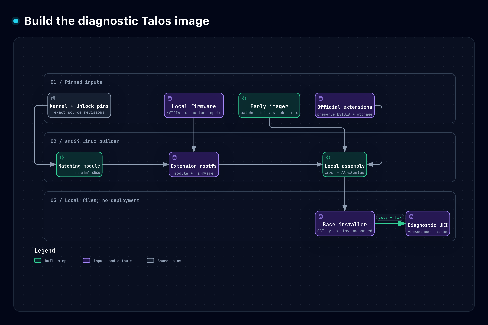
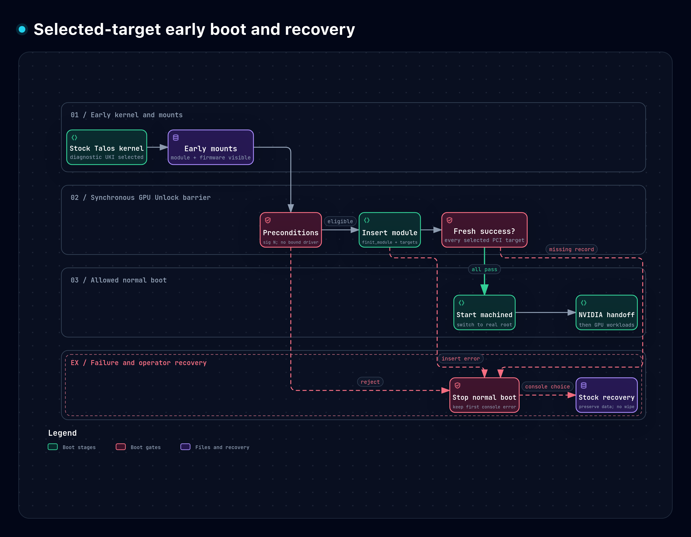
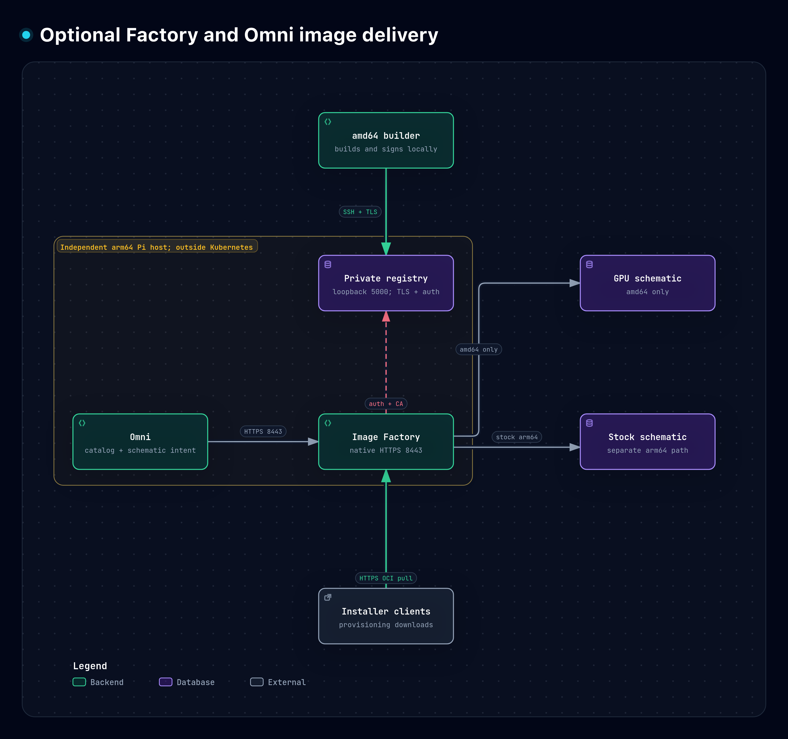
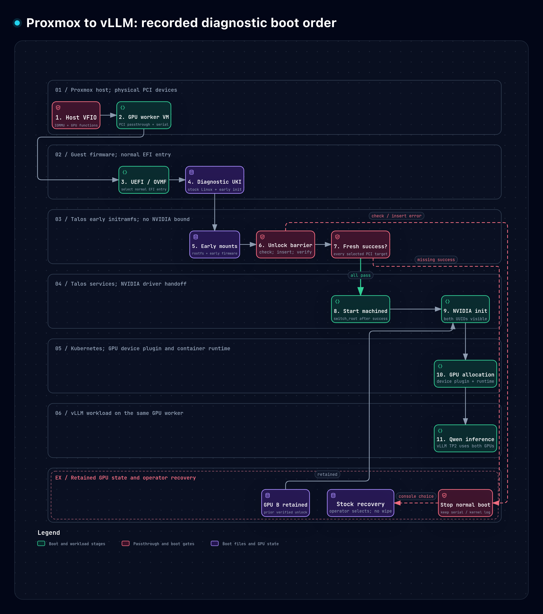

# Explore the implementation

**Start with the [Proxmox-to-vLLM boot flow](proxmox-boot.html). Download the HTML and open it in your browser.**

On bare metal, skip the Proxmox-specific stages and use [early boot and recovery](boot.html).

The previews work inside GitHub Markdown. The interactive HTML works offline after download, without an Archify installation.
GitHub does not run an HTML file inside a Markdown page.

1. **[Follow the full Proxmox boot](proxmox-boot.html):** host VFIO → guest firmware → Talos barrier → NVIDIA → Kubernetes → vLLM.
2. **[Build the image](build.html):** source pins → matching module → extension → installer and diagnostic sidecar.
3. **[Follow early boot](boot.html):** early mounts → checks → fresh unlock success → NVIDIA, or stock recovery.
4. **[See optional image delivery](factory.html):** desktop builds, private registry, independent Pi services, and separate architecture paths.

The diagrams freeze the earlier diagnostic implementation, not a newly observed live state.
The current assembler now embeds the corrected UKI directly in its installer; the sidecar build map is historical.
See the [current simple guide](../../SIMPLE-GUIDE.md) for the updated build workflow.
The current loader targets one GPU. The other retains its preceding verified unlock.
The corrected diagnostic sidecar is not yet the verified Omni-managed installer.

## 1. Build locally



**Read it this way:** compilation and assembly run on the amd64 builder. The installed Talos kernel stays stock.
[Interactive HTML](build.html) · [Editable source](build.workflow.json)

## 2. Follow early boot and recovery



**Read it this way:** every selected target needs fresh success. `EALREADY` does not satisfy the barrier.
Preserve the stock recovery entry and quiesce storage clients before an approved shutdown.
[Interactive HTML](boot.html) · [Editable source](boot.workflow.json)

## 3. Separate management from provisioning



**Read it this way:** the Pi services remain outside Kubernetes. GPU schematics are amd64-only.
Stock schematics retain both architectures; this view highlights their separate arm64 path.
The Pi is our deployment choice, not a Talos requirement.
The map does not show an automatic migration to the corrected diagnostic UKI.
[Interactive HTML](factory.html) · [Editable source](factory.architecture.json)

## 4. Follow Proxmox through Talos to vLLM



Read the numbered path in five groups:

1. **Proxmox:** host IOMMU/VFIO makes the GPU functions available to the configured VM.
2. **Guest firmware:** UEFI/OVMF selects the normal diagnostic UKI, containing stock Linux and the early initramfs.
3. **Talos early boot:** mount root and firmware; check targets; insert GPU Unlock; require fresh success before continuing.
4. **Driver handoff:** switch root, start `machined`, initialize NVIDIA, and expose GPUs through the container runtime and device plugin.
5. **Workload:** Kubernetes allocates both GPUs to vLLM; Qwen runs with tensor parallelism 2.

**The critical barrier is between groups 3 and 4.** An error stops normal boot before NVIDIA binds the selected target.
The diagram records the tested diagnostic session. It does not report a new boot or a fresh live-state check.
GPU A is initialized in that boot. GPU B supplies retained state from its preceding verified unlock.

Omni's lock guards management reconciliation; it is not a runtime boot stage.
The corrected diagnostic UKI still differs from the managed candidate.
Stock recovery remains an operator choice after preserving logs and quiescing affected storage clients.
A guest restart does not guarantee a hardware reset.

[Interactive HTML](proxmox-boot.html) · [Editable source](proxmox-boot.workflow.json) · [Proxmox chapter](../../docs/08-proxmox.md)

<details>
<summary>Rebuild the interactive files</summary>

Use Node.js and an available Chrome/Chromium binary on the builder.
Use a full integration repository clone containing commits `09a9d83a17c1331d2bf6a9d4fd6bde5f4d9f965c` and `fe6feb6cfa704cd2a2661fef61c93d1bae879216`.
A downloaded ZIP has no Git history and cannot satisfy the repository-evidence gate.

Run these commands from the integration repository root:

```bash
git clone --branch v3.2.0 --depth 1 \
  https://github.com/tt-a1i/archify.git work/archify
bash scripts/render-diagrams.sh "$PWD/work/archify" "$PWD/work/diagram-review"
```

The wrapper verifies the Archify commit, then runs artifact and real-browser checks for each diagram.
It writes into a new directory and does not overwrite the published files.
The JSON sources preserve the exact source revision and inspected line ranges.
Their source cards use `local-only` evidence bound to the frozen commits listed above.
This limitation does not mean the diagrams lack verified source evidence.

To refresh a preview, open its checked HTML and choose **Export → PNG**.
The committed previews are canonical exports, not screenshots containing viewer controls.
A new export is not proof of a Talos boot or a performance measurement.

</details>

<details>
<summary>Tool versions, verification, and licenses</summary>

[toolchain.json](toolchain.json) pins Archify v3.2.0 and its exact commit.
[validation.json](validation.json) records artifact hashes and the completed checks without private host paths.
Full receipts and browser captures remain private because they contain local paths.
The published HTML bytes match the checked artifacts.

Archify's viewer code is covered by [LICENSE.txt](LICENSE.txt).
Embedded fonts and optional marks have separate [third-party notices](THIRD-PARTY-NOTICES.md).
These diagrams request no product brand marks.

</details>

**Next — 2 minutes:** [open the early-loader chapter](../../docs/05-early-boot.md) and locate the execution point.
