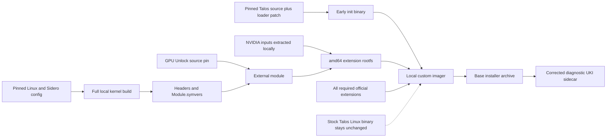
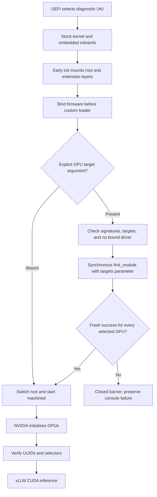
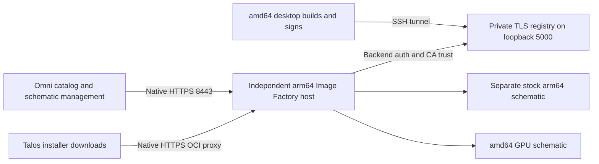
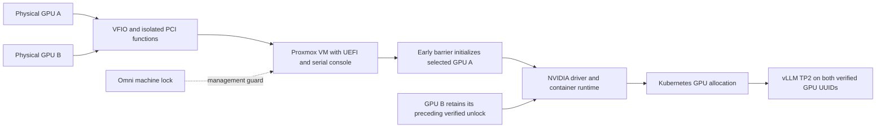
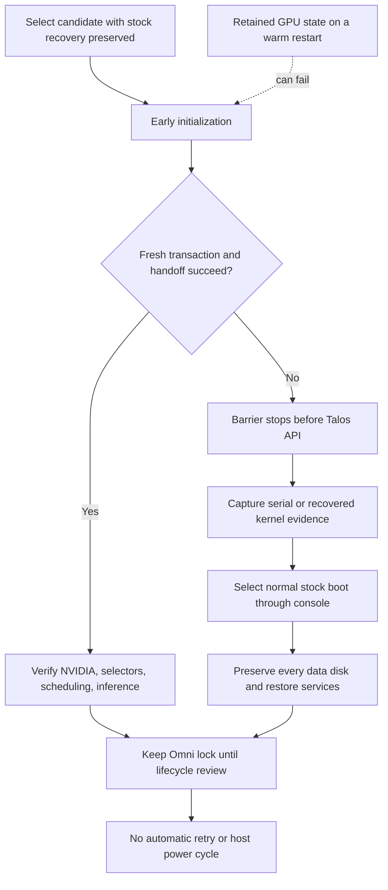

# Architecture

The diagrams describe the tested ordering and remaining management boundary.
The currently selected loader initializes one card; the second retains its prior verified unlock.

## Build pipeline

[Rendered SVG](../diagrams/build.svg)

## Early boot sequence

[Rendered SVG](../diagrams/boot.svg)

## Registry, factory, and Omni

[Rendered SVG](../diagrams/factory.svg)

## Passthrough to vLLM

[Rendered SVG](../diagrams/passthrough.svg)

## Failure and recovery

[Rendered SVG](../diagrams/recovery.svg)

GPU schematics are amd64-only. Stock arm64 uses a separate schematic.
The management services remain independent of Kubernetes availability.
Rendered SVGs sit beside their Mermaid sources in `diagrams/`.
