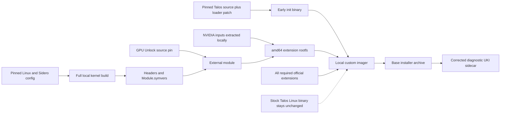
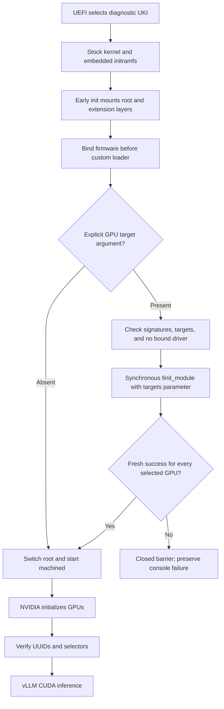
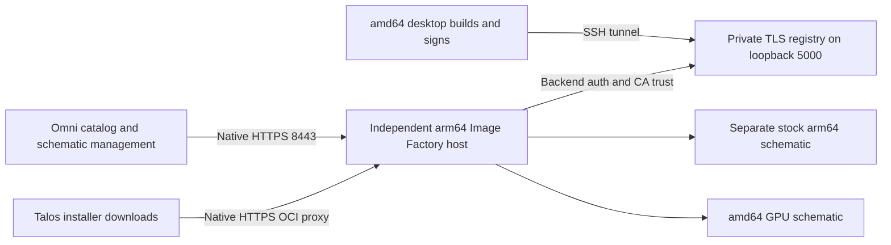
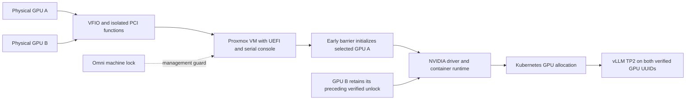
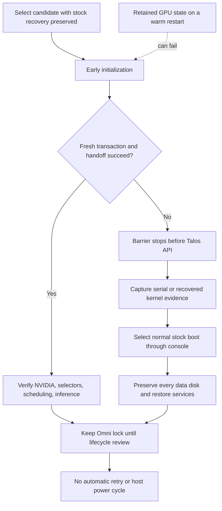

# Architecture

**Start — 2 minutes:** follow the early-boot diagram before reading the source patches.

**You are here:** visual reference · five system views.

**Done when:** you can locate the early barrier and the remaining managed-image gap.

**Interactive views:** [open the Archify diagram index](../diagrams/archify/README.md).
The five Mermaid views below remain available as static references.

The diagrams describe the tested ordering and remaining management boundary.
The currently selected loader initializes one card; the second retains its prior verified unlock.

## 1. Build pipeline



<details>
<summary>Open Mermaid source</summary>



</details>

## 2. Early boot sequence



<details>
<summary>Open Mermaid source</summary>



</details>

## 3. Registry, factory, and Omni



<details>
<summary>Open Mermaid source</summary>



</details>

## 4. Passthrough to vLLM



<details>
<summary>Open Mermaid source</summary>



</details>

## 5. Failure and recovery



<details>
<summary>Open Mermaid source</summary>



</details>

GPU schematics are amd64-only. Stock arm64 uses a separate schematic.
The management services remain independent of Kubernetes availability.
Rendered SVGs sit beside their Mermaid sources in `diagrams/`.

<details>
<summary>Render all five diagram sources locally</summary>

### Render the Mermaid sources

Use a headless Chromium configuration at `PUPPETEER_CONFIG`.
The recorded local renderer was Mermaid CLI 11.12.0.

```bash
PUPPETEER_SKIP_DOWNLOAD=1 npm exec --yes --package=@mermaid-js/mermaid-cli@11.12.0 -- \
  mmdc -p "$PUPPETEER_CONFIG" -i diagrams/boot.mmd -o diagrams/boot.svg
```

Repeat for the other four source files. Rendering does not contact Talos or change a VM.

</details>

---

[Guide home](../README.md) · **Next — 2 minutes:** [open the early-loader insertion point](05-early-boot.md).
