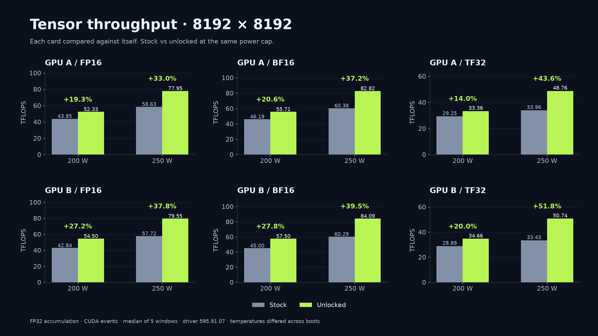
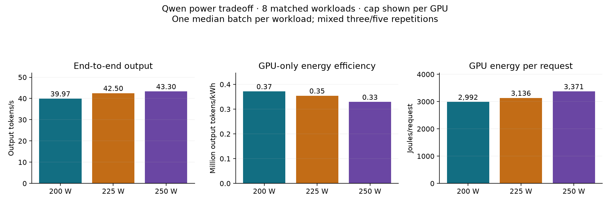

# Supporting performance evidence

**Start — 2 minutes:** read the same-card table and the power recommendation.

**You are here:** supporting evidence · installation remains the main guide.

**Recommendation:** the measured mix favors 200 W per GPU for energy; 225 W offers an interactive tradeoff.

Performance supports the installation evidence. It does not replace fresh initialization logs and verified GPU state.
No benchmark was repeated for documentation.

## 1. Controlled same-card GEMM

GPU B was measured against itself before and after unlocking.

GEMM controls and accumulation settings

NVIDIA driver, kernel, UUID, benchmark implementation, and power limits were held constant.
The benchmark used CUDA event timing, warmups, FP32 accumulation, and five measured windows.
Reduced FP16/BF16 reduction and FP16 accumulation were disabled.

| Power | Stock BF16 | Unlocked BF16 | Same-card gain |
|---|---:|---:|---:|
| 200 W | 45.00 TFLOPS | 57.50 TFLOPS | 27.8% |
| 250 W | 60.29 TFLOPS | 84.09 TFLOPS | 39.5% |

The preliminary 59.23 versus 50.69 TFLOPS comparison used different physical cards.
It is not a causal same-card before/after result.
The [upstream #17 report](https://github.com/Zagitta/gpu-unlock/issues/17) used 420 W and another system.
Its roughly 67% BF16 gain is not directly comparable to a 200 W production cap.

The [full sanitized GEMM data](../evidence/gemm-same-card.json) includes all 24 matched comparisons and power/clock telemetry.
The [visual showcase](showcase.md) also includes 4096-square results and real Qwen charts.

## 2. Production Qwen inference

The verified primary baseline was GPU A stock / GPU B unlocked, compared with both unlocked.
Those roles reverse the earliest historical mixed configuration.
The initial fresh `qwen-before` record had unverified GPU A state and was not the controlled primary baseline.
At the same 200 W limits, model, FP8 quantization, vLLM version, and TP=2:

- Prefill increased 14–22% across concurrency 1/2/4.
- Aggregate output throughput increased 7–11%.
- Decode showed no demonstrated improvement.

FP8 weight quantization does not make every operation native FP8 on Ampere.
The recorded runtime selected Marlin FP8 weight processing with BF16 activations and FlashInfer attention.
GEMM gains do not imply equal decode or end-to-end gains.

## 3. Power-efficiency study

Both GPUs were unlocked throughout this separate experiment.
This compares power limits, not stock versus unlocked hardware.

Shortened sweep and matched-workload methodology

The original 270-batch plan was shortened.
It retained 25 five-repetition configurations, added nine three-repetition configurations, and kept two partial configurations separately.
The primary three-cap comparison uses eight matched workloads with at least three repetitions.
Each workload contributes one median batch, independent of its sample count.

| Limit per GPU | Output tokens/s | Actual combined W | GPU-only output tokens/kWh |
|---|---:|---:|---:|
| 200 W | 39.97 | 387.4 | 371,440 |
| 225 W | 42.50 | 431.8 | 354,345 |
| 250 W | 43.30 | 472.8 | 329,672 |

200 W is the electricity-saving default for this measured mix.
225 W adds 6.3% throughput and 4.8% energy per request overall.
It is a practical interactive alternative, with near-tied energy in single-request tests.
250 W adds only 1.9% throughput over 225 W while using 7.5% more energy.
Both GPUs were restored to 200 W and normal daemon enforcement resumed.

Energy integrates both GPUs' instantaneous NVML power every 100 ms.
Cumulative counters reported lower totals; both paths ranked 200 W most efficient in the matched mix.
These are GPU-sensor estimates, not calibrated wall-meter or whole-server electricity measurements.
Warmups, request gaps, and whole-server idle energy are excluded from the efficiency totals.
Example electricity cost uses $0.20/kWh, not a claim about an operator's actual rate.

Read [benchmarks.json](../evidence/benchmarks.json) for sanitized numeric evidence and methodology.
Private raw measurements remain preserved with the operator.

---

[Guide home](../README.md) · **Next — 2 minutes:** [check what remains unvalidated](13-known-limitations.md).
