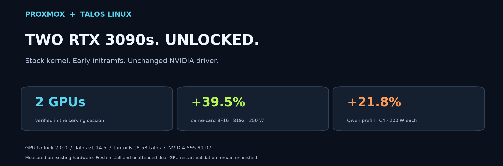
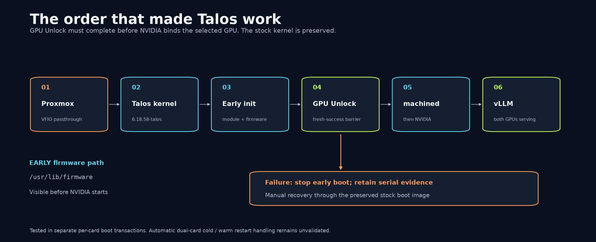
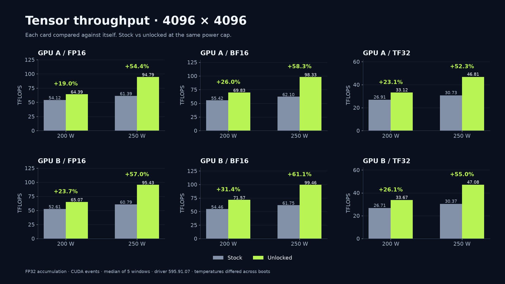
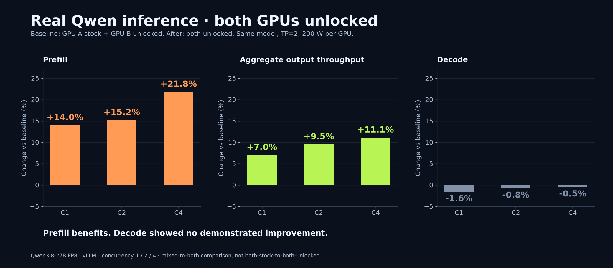
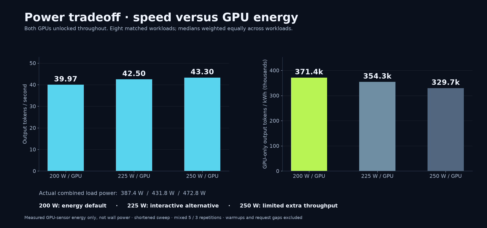

# Proxmox + Talos Linux: two RTX 3090s unlocked

**Start with the [five-step guide](../SIMPLE-GUIDE.md).** Use this page to inspect the implementation and its measured results.



The stock Talos kernel remains unchanged. A matching external module runs through a synchronous early-initramfs loader before NVIDIA initializes.

## The boot sequence



Both cards completed fresh unlock transactions in separate boots.
The diagnostic serving session initialized GPU A while GPU B retained its preceding verified unlock.
Automatic dual-card cold/warm restart handling remains unfinished.

Read the [actual early-loader implementation](05-early-boot.md) and [sanitized boot evidence](../evidence/verified-case.json).
The existing [interactive Archify diagrams](../diagrams/archify/README.md) remain optional references.

## Tensor Core performance: each GPU against itself


Each bar shows the median of five CUDA-event windows.
FP16/BF16 use FP32 accumulation with reduced-precision reduction disabled. TF32 is explicitly enabled for FP32 inputs.
Before and after measurements crossed a boot/reset; initial temperatures differed.
These are same-card comparisons of the tested reset/unlock procedure, not randomized crossover measurements.

<details>
<summary>Open all 4096-square results</summary>



Matrix size matters. GPU B BF16 gained 61.1% at 4096 square and 250 W, compared with 39.5% at 8192 square.
Do not substitute the larger percentage for the 8192-square result.

</details>

Read all [24 matched comparisons and telemetry](../evidence/gemm-same-card.json).
The [benchmark chapter](benchmarks.md) explains the methodology and earlier cross-card results.

## Real Qwen inference



Baseline: GPU A stock, GPU B unlocked. After: both unlocked.
The model, FP8 quantization, TP=2, request payloads, and 200 W power limits remained constant.
Concurrency 1/2/4 produced the displayed results. This is not a both-stock-to-both-unlocked comparison.

## Choose watts using measured energy



200 W per GPU was the energy default for this measured workload mix.
225 W offered an interactive tradeoff. 250 W added relatively little throughput.
Energy uses both GPUs' measured power, not their configured limits.
These are GPU-sensor estimates, not whole-server or wall-meter measurements.
The shortened sweep combines five- and three-repetition configurations. Eight workloads support the matched three-cap comparison.

## Build and evidence boundaries

The new assembler embeds the corrected UKI in the installer and accepts explicit PCI targets.
GPU-2-only and dual-target archives passed offline validation. Those new archives have not been installed or boot-tested.
Fresh installation, bare-metal operation, and Omni-managed promotion remain unvalidated.

Read [installer validation](../evidence/installer-validation.json) and [remaining production work](13-known-limitations.md).
The graphics reuse existing measurements. No new GPU experiment was run for this page.

## Rebuild the graphics

Run from the repository root with Python and uv available:

```bash
uv run --with-requirements scripts/requirements-visuals.txt python scripts/render-showcase.py
```

The renderer reads sanitized JSON and writes PNG, SVG, and source/output checksums.
It does not query GPUs or contact the cluster.
Read [graphics provenance](assets/showcase/validation.json) for the exact source hashes.
